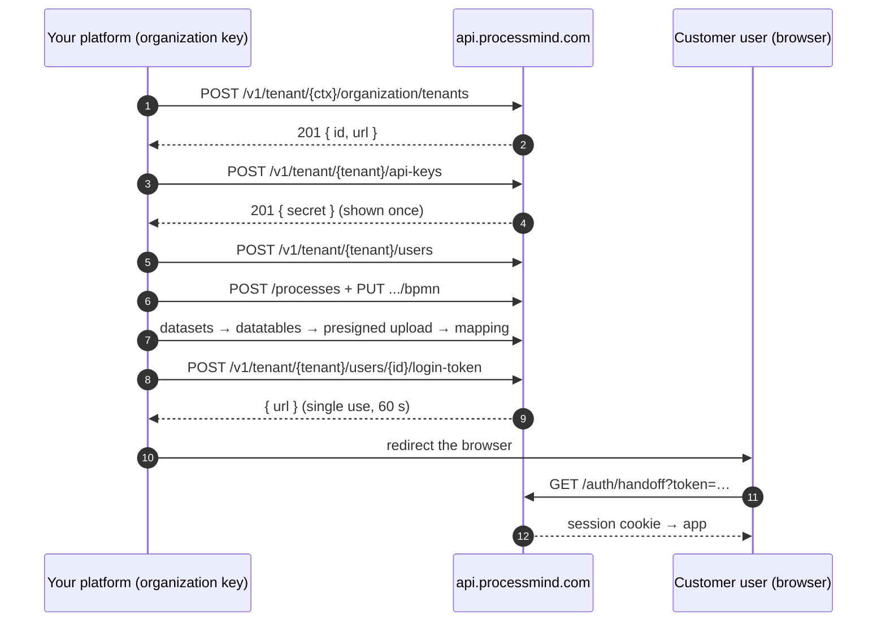

# ProcessMind API Examples

Runnable examples for the [ProcessMind](https://processmind.com) External API — updated for the versioned **`/v1`** API.

- **Base URL:** `https://api.processmind.com` — every route lives under `/v1`
- **Authentication:** API key in the `x-api-key` header
- **Machine-readable spec:** [`GET /v1/openapi.json`](https://api.processmind.com/v1/openapi.json) (OpenAPI 3.1, public — no key needed)
- **Docs:** [processmind.com/resources/docs/api](https://processmind.com/resources/docs/api)

The examples walk the journey most integrations need: **provision a customer tenant, add its users, load the latest BPMN models and event-log data, map them together, and hand the customer a one-time login link.**

*Updated for the v1 API — 2026-10-14. Maintainers re-run the examples against a scratch workspace before releasing (see [CONTRIBUTING.md](CONTRIBUTING.md)).*

## Quickstart (60 seconds)

Requires **Node.js 18+** (no install) and an API key — create one in the app under *Settings → API Keys*.

```bash
git clone https://github.com/ProcessMindBV/api-examples.git
cd api-examples

export PROCESSMIND_API_KEY="pm-…"           # your key
export PROCESSMIND_TENANT_ID="<tenant id>"  # your workspace id

node javascript/quickstart.mjs
```

You should see your workspace, its organization and its processes.

## Configuration

All examples read configuration from environment variables:

| Variable | Required | Meaning |
|---|---|---|
| `PROCESSMIND_API_KEY` | yes | API key — use an **organization key** for provisioning, a **tenant key** for one workspace |
| `PROCESSMIND_TENANT_ID` | yes | Tenant the key acts on (the *context tenant* for organization calls) |
| `PROCESSMIND_API_URL` | no | Defaults to `https://api.processmind.com` |

Keys are issued in the app under *Settings → API Keys*; the secret is **shown once**, so store it in a secret manager and never commit it.

### Scopes

| Scope | Default | Grants |
|---|---|---|
| `read` | on | List/get endpoints |
| `write` | on | Create/update/delete endpoints |
| `uploadData` | on | Presigned and multipart upload URLs for datatables |
| `sessions` | **off** | One-time login handoff tokens (`/users/{userId}/login-token`) |

Enable `sessions` only for keys that mint login links — a minted token logs the user in without a password.

### Key types

- **Tenant key** — acts on a single tenant. It can never read another tenant, and it cannot use organization routes (HTTP 403).
- **Organization key** — works across every tenant of the organization. Required to create tenants, manage tenant API keys and manage organization users.

## Examples

Every file runs standalone; the flagship walks the whole journey end to end. Python needs `pip install -r python/requirements.txt` once.

| Journey | JavaScript | Python | curl |
|---|---|---|---|
| Quickstart — read workspace + processes | [`javascript/quickstart.mjs`](javascript/quickstart.mjs) | [`python/quickstart.py`](python/quickstart.py) | [cheatsheet §1](bash/curl-cheatsheet.md) |
| Provision a customer tenant + API key | [`javascript/provision-tenant.mjs`](javascript/provision-tenant.mjs) | [`python/provision_tenant.py`](python/provision_tenant.py) | [§2–3](bash/curl-cheatsheet.md) |
| Add users (seat-aware) | [`javascript/add-users.mjs`](javascript/add-users.mjs) | [`python/add_users.py`](python/add_users.py) | [§4](bash/curl-cheatsheet.md) |
| Load BPMN models into processes | [`javascript/load-bpmn.mjs`](javascript/load-bpmn.mjs) | [`python/load_bpmn.py`](python/load_bpmn.py) | [§5](bash/curl-cheatsheet.md) |
| Load event-log data + map it to a model | [`javascript/load-data.mjs`](javascript/load-data.mjs) | [`python/load_data.py`](python/load_data.py) | [§6–7](bash/curl-cheatsheet.md) |
| Mint a one-time login link | [`javascript/login-link.mjs`](javascript/login-link.mjs) | [`python/login_link.py`](python/login_link.py) | [§8](bash/curl-cheatsheet.md) |
| **Full journey, end to end** | [`javascript/full-onboarding.mjs`](javascript/full-onboarding.mjs) | [`python/full_onboarding.py`](python/full_onboarding.py) | [whole cheatsheet](bash/curl-cheatsheet.md) |

## The multi-tenant journey in one picture



Notes:

1. **Tenant creation follows your plan allowance** — partner organizations are uncapped; each tenant gets its own database and a subdomain (`https://<shortName>.processmind.com`).
2. **Users**: the API never sends invitation emails. Create the user, then use a login link (or invite them your own way). Seats (`access`) are single-select: `none`, `portalViewer`, `designer`, `architect`, `intelligence`; `isDashboardViewer` is a boolean for read-only dashboard access, not a seat.
3. **BPMN import replaces the current model.** Snapshot a version first (`POST .../versions`) if you overwrite on a schedule — see [docs/recipes.md](docs/recipes.md).
4. **Data uploads** go through a presigned URL; the pipeline processes the file automatically. For multi-GB files use the multipart endpoints, for daily increments use `delta=true&partnumber=N` — see [docs/recipes.md](docs/recipes.md).
5. **Login links are single-use, valid for 60 seconds and password-equivalent.** Send the user's browser to the returned URL immediately, never log it, and never mint it from browser-side code.

## Common errors

| Status | When | What to do |
|---|---|---|
| `401` | Key is invalid, or is scoped to a different tenant | Check the key and that `PROCESSMIND_TENANT_ID` is its tenant |
| `403` | Missing scope (e.g. `sessions`), tenant key used on an organization route, or a plan gate | Check scopes and key type |
| `406` | Tenant `shortName` is reserved or already taken | Choose another `shortName` |
| `409` / `403` | Seat capacity: `SEAT_LIMIT_EXCEEDED`, `FREE_CAP`, `FREE_USER_CAP`, … | See [docs/recipes.md](docs/recipes.md#seat-gate-errors); `GET /organization/billing/seats` shows the contract |
| `413` | Upload is larger than your plan's limit | Use a smaller export, or a plan with a higher limit |
| `429` | Rate limited (some routes throttle, e.g. login tokens) | Back off and retry |

Per-operation auth, rate limits and typed errors are in the [OpenAPI document](https://api.processmind.com/v1/openapi.json).

## What this API does not do

- **No connectors** — data arrives as a file export (CSV, TSV, TXT, XES, XLS/XLSX/XLSB, Parquet, ORC, JSONL/NDJSON, optionally gzip) or an API push.
- **No built-in scheduler** — recurring loads are your job calling the API.
- **Case-centric mining only** — object-centric (OCEL) event logs are not produced or consumed.
- **No dashboard-definition endpoints** — dashboards are built in the app; the API feeds them with data, models and analysis.
- **No deprecation policy yet** — don't assume a support window; watch the [OpenAPI watch pull requests](https://github.com/ProcessMindBV/api-examples/pulls).
- The **MCP server** for AI assistants is a separate surface and an **Enterprise-plan** capability.

## MCP — for AI assistants

Beyond REST, ProcessMind ships a Model Context Protocol server so assistants can read and edit process content. It is an Enterprise-plan capability and does not cover datasets or tenant administration. See [MCP server docs](https://processmind.com/resources/docs/api/mcp-server).

## Repository layout

```
javascript/   Node 18+ examples — zero dependencies (built-in fetch)
python/       the same examples — only requests
bash/         curl cheatsheet for the whole journey
docs/         recipes for production-shaped tasks (rotation, deltas, offboarding)
spec/         OpenAPI snapshot, refreshed by the OpenAPI watch workflow
```

## Contributing, security, license

- [CONTRIBUTING.md](CONTRIBUTING.md) — run what you change against a scratch workspace.
- [SECURITY.md](SECURITY.md) — never commit a key; login links are password-equivalent.
- [MIT license](LICENSE).

Questions? Use the [contact page](https://processmind.com/about/contact-us) or open an issue.

---

**ProcessMind** unifies process mining, modeling and simulation in one SaaS platform. **Process mining** analyzes event logs from systems like ERP and CRM to show how work actually happens — and where it can improve.
